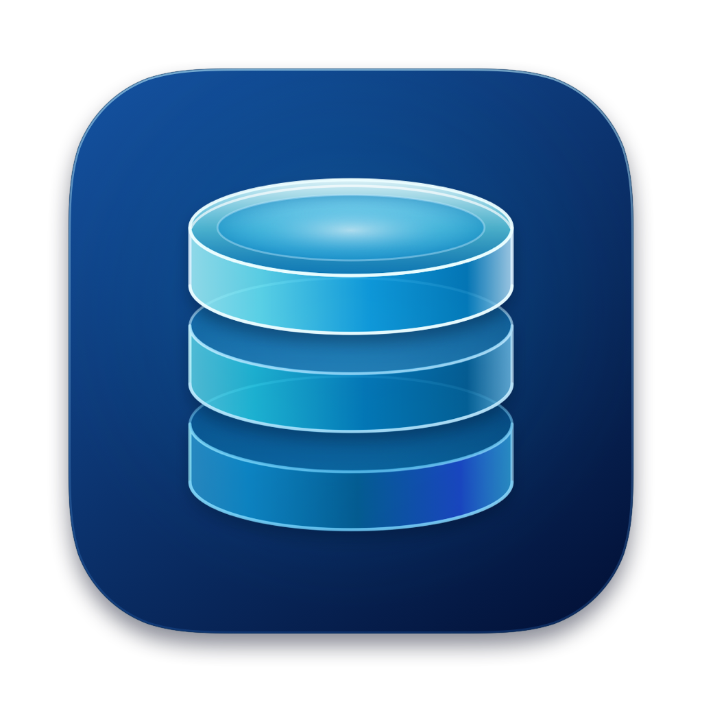
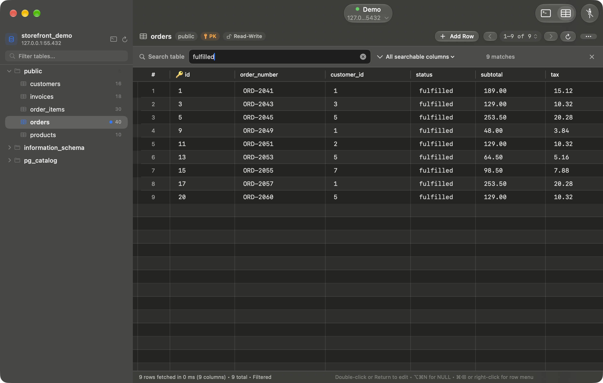
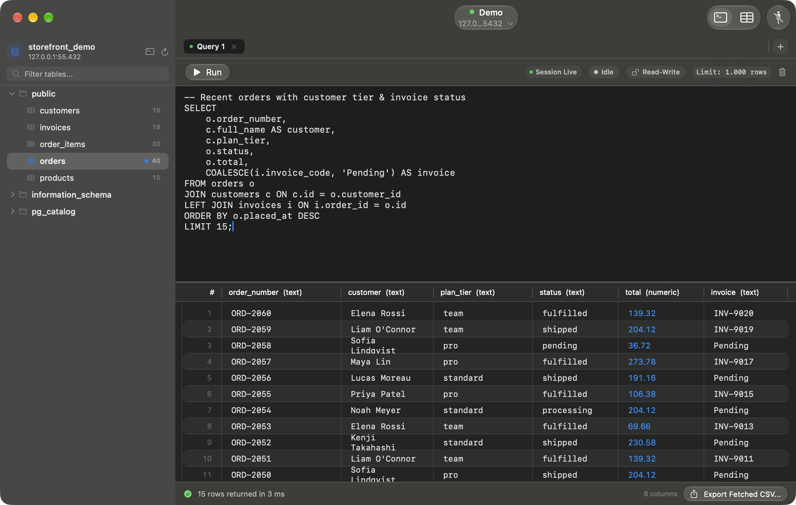
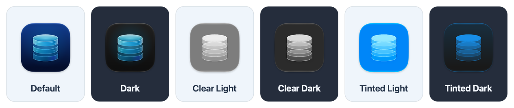

<p align="center">
  
</p>

<h1 align="center">LucidSQL</h1>

<p align="center">
  A fast, native macOS PostgreSQL client built with SwiftUI, AppKit, and Rust.
</p>

<p align="center">
  <a href="https://github.com/LightAndy1/LucidSQL/actions/workflows/ci-and-release.yml"></a>
  <a href="https://github.com/LightAndy1/LucidSQL/releases"></a>
  <a href="https://github.com/LightAndy1/LucidSQL/issues"></a>
  <a href="#requirements--installation"></a>
</p>

<p align="center">
  <a href="#features">Features</a> ·
  <a href="#requirements--installation">Installation</a> ·
  <a href="#sql-editor-workflow">SQL Editor</a> ·
  <a href="#building-from-source">Build</a> ·
  <a href="docs/REFERENCE.md">Reference</a> ·
  <a href="LICENSE">AGPL-3.0 License</a>
</p>

<p align="center">
  
</p>

## Features

- **Native Schema & Table Browsing:** Tree-based schema/table sidebar with quick table filtering and a virtualized AppKit spreadsheet grid (`NSTableView`) for fast scrolling and keyboard navigation.
- **Non-SQL Table Search & Pagination:** Press `⌘F` for case-insensitive literal filtering across searchable columns alongside compact pagination controls (`25`–`500` rows per page).
- **Safe Staged Editing:** Edit cells, insert rows, and delete rows locally (`⌥⌘N` for `NULL` vs. `""`), review a pre-commit diff, and apply atomically with `xmin` conflict checking.
- **Dedicated-Session SQL Editor:** Multi-tab SQL editor (`⌘↩` to run) where each tab holds its own persistent PostgreSQL session (`search_path`, temp tables, transactions), with live query cancellation and close-tab rollback prompts.
- **Dual-Enforced Read-Only & CSV Snapshots:** Lock connections across both UI and Rust/PostgreSQL (`BEGIN READ ONLY`), or export consistent `REPEATABLE READ READ ONLY` CSV snapshots.
- **Local Profiles & Keychain Credentials:** Import `postgres://` URLs with configurable TLS (`disable` to `verify-full`) and store passwords in macOS Keychain or session memory only.

## Requirements & Installation

- **Mac:** Apple Silicon (`arm64`) running **macOS 14.0 (Sonoma)** or later.
- **Appearance:** Builds compiled with the **Xcode 26 SDK** render native **Liquid Glass** surfaces and layered `.car` icon appearances on **macOS 26+**, falling back cleanly to standard system materials and `LucidSQL.icns` on older macOS releases or CommandLineTools builds.

> **Release status:** No public GitHub Release has been published yet. Signed development `.dmg` artifacts and `.sha256` checksums are produced on [GitHub Actions](https://github.com/LightAndy1/LucidSQL/actions/workflows/ci-and-release.yml); tagged releases will appear on [GitHub Releases](https://github.com/LightAndy1/LucidSQL/releases) once published.

1. Download the `.dmg` archive (and verify with `shasum -a 256 -c LucidSQL-*.dmg.sha256` if included).
2. Open the `.dmg` and drag **`LucidSQL.app`** into **`Applications`**.
3. **Ad-hoc signing notice:** Distributed `.app` / `.dmg` builds are **ad-hoc signed and not Developer ID notarized**. On first launch, macOS Gatekeeper will block opening directly:
   1. Try opening **LucidSQL** once from Finder or Applications, then dismiss the warning.
   2. Open **System Settings → Privacy & Security**, scroll to **Security**, and click **Open Anyway** next to LucidSQL.

## SQL Editor Workflow

Each query tab isolates its own lazy PostgreSQL session so `SET search_path`, temporary tables, and open transactions work predictably without blocking schema browsing.

<p align="center">
  
</p>

## Native App Icon Appearances

The layered vector icon in [`Assets/AppIcon/LucidSQL.icon`](Assets/AppIcon/LucidSQL.icon) compiles via Xcode 26 `actool` into `Assets.car` alongside a full-resolution `LucidSQL.icns` fallback. Below are **macOS system-rendered previews** captured from the CI-compiled `Assets.car` on macOS 27 (tint appearance adapts dynamically to the system accent color):

<p align="center">
  
</p>

## Building from Source

Requires an Apple Silicon Mac (`arm64`), [Rust](https://rustup.rs/) (`cargo`), and Xcode Command Line Tools (or **Xcode 26+** for Liquid Glass SDK symbols and `actool` `.icon` compilation; optional `postgresql@16` for database tests):

```bash
./scripts/build-rust-bridge.sh                               # Build Rust core & UniFFI Swift bindings
./tests/bridge_smoke_test.sh                                 # Run Rust + Swift test suites
./scripts/run-app.sh                                         # Launch local debug bundle
./scripts/package-app.sh --configuration release --signing-mode adhoc --dmg
```

See [docs/DISTRIBUTION.md](docs/DISTRIBUTION.md) for `--require-liquid-glass`, `--require-native-icon`, and `verify-dmg.sh` relocation checks.

## Privacy & Important Limitations

- **Zero telemetry:** LucidSQL sends no analytics, crash reports, or third-party requests. Connection profiles (`profiles.json`) and optional SQL drafts (`sql_drafts.json`) live locally; passwords reside only in macOS Keychain or session memory. See [docs/REFERENCE.md](docs/REFERENCE.md) for exact paths and TLS options.
- **Apple Silicon & direct TCP/TLS only:** Intel (`x86_64`), SSH tunneling, multi-host failover strings, and Unix-socket `postgres://` URLs are not supported.
- **Search & export scope:** Non-SQL Table Search (`⌘F`) skips binary, JSON, array, geometric, and range columns; SQL Editor results cap at `1,000` rows by default, and CSV export always reads committed rows.
- **Distribution & fallback behavior:** Unnotarized ad-hoc builds require the per-app **Open Anyway** flow above; CommandLineTools-only builds omit `Assets.car` and render standard non-Liquid-Glass system chrome.

## License

Licensed under the **GNU Affero General Public License v3.0** (`AGPL-3.0-only`). See [LICENSE](LICENSE).
